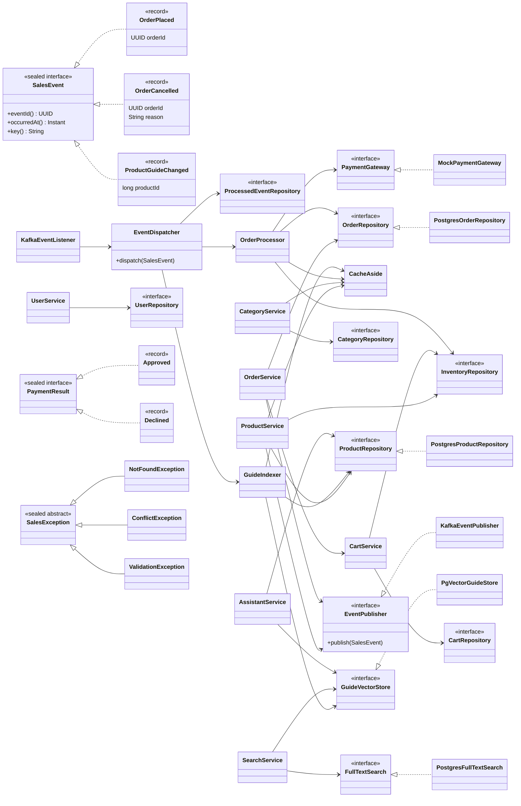
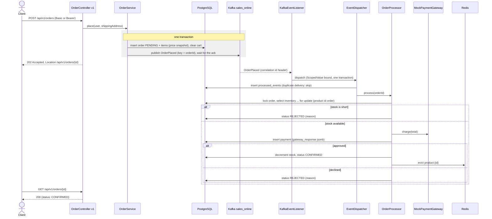
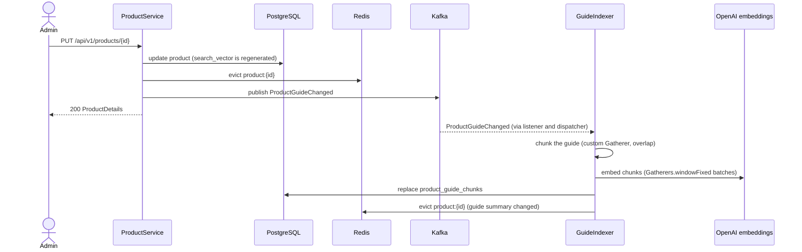
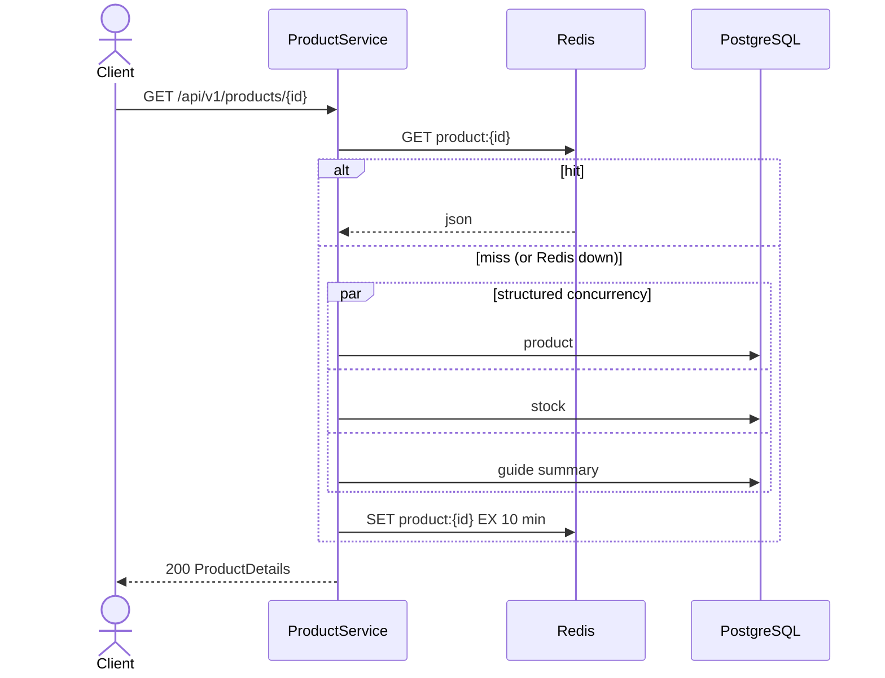
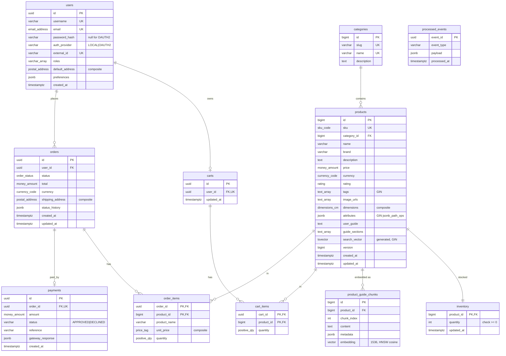

# Sales Online - Architecture

A single Spring Boot application (Java 25 with preview features), packaged by feature. Each feature has a `domain` package (records, services, port interfaces) and adapter packages: `api` (v1 REST controllers), `persistence/postgres` and `messaging/kafka`. The persistence and messaging adapters are selected by `sales.persistence.provider` and `sales.messaging.provider`; only PostgreSQL and Kafka exist today.

| Concern | Implementation |
|---|---|
| API | Spring MVC, path versioning `/api/v{version}` (`ApiVersioningConfig`), OpenAPI at `/v3/api-docs/v1`, Swagger UI at `/swagger-ui.html` |
| Security | HTTP Basic (`users` table, BCrypt) and OAuth2 bearer JWT from the broker (`typ` `JWT` or `at+jwt`) |
| Errors | RFC 9457 problem responses with `correlationId` (`GlobalExceptionHandler`) |
| Data | PostgreSQL via `JdbcClient` + records, Flyway migrations, pgvector |
| Cache | Redis cache-aside (`CacheAside`): `product:{id}`, `category:all`, `product-page:...` |
| Async | Kafka topic `sales_online` (dead letters in `sales_online-dlt`) |
| AI | Spring AI with OpenAI: embeddings for guide chunks, chat for RAG answers |

## Class diagram (core domain)



Every port has a Postgres adapter (`Postgres*Repository`); only a few are drawn.

## Sequence: asynchronous order placement



A failed event is retried with backoff and then sent to `sales_online-dlt`. If the broker is down when the order is placed, the transaction rolls back, the cart is kept and the client gets `503`.

## Sequence: product update and guide re-embedding



## Sequence: cache-aside product read



## Sequence: authentication

```mermaid
sequenceDiagram
    actor C as Client
    participant B as OAuth2 broker :8443
    participant F as Security filter chain
    participant US as UserService
    participant DB as PostgreSQL
    alt HTTP Basic
        C->>F: Authorization: Basic
        F->>US: loadUserByUsername
        US->>DB: select LOCAL user (BCrypt hash, roles)
    else Bearer JWT
        C->>B: authorization code + PKCE
        B-->>C: access token (typ at+jwt)
        C->>F: Authorization: Bearer
        F->>B: JWKS (cached, TLS via broker truststore)
        F->>F: verify signature, expiry, issuer, typ; roles from scope
        F->>US: current(jwt)
        US->>DB: find by external_id = sub, or insert OAUTH2 user
    end
    F-->>C: 401 / 403 problem response on failure
```

## Database (schema `sales_online`)



Array columns are written as `text_array` / `varchar_array` because mermaid cannot render `text[]`. Custom domains (`email_address`, `sku_code`, `money_amount`, `currency_code`, `positive_qty`, `rating`, `order_status`) and composite types (`postal_address`, `dimensions_cm`, `price_tag`) are defined in `V1__types.sql`.

Views (`V3__views.sql`): `v_product_catalog` (product, category, stock, `in_stock`), `v_order_summary` (order with items as `jsonb_agg` and flattened address), `v_category_stats` (counts, price range, distinct tags). Indexes: GIN on `search_vector`, `tags` and `attributes`; HNSW on `embedding`; B-tree on `products(category_id)` and `orders(user_id, created_at desc)`.

## Tests

| Suite | Command | Runs against |
|---|---|---|
| Unit (`*Test`) | `./mvnw test` | mocks and fakes |
| Integration (`*IT`) | `./mvnw verify` | dev servers, schema `sales_online_test`, Redis DB 1, topic `sales_online_test`, fake AI models, self-signed test JWTs |
| End-to-end (`*E2E`) | `./mvnw -Pe2e verify` | the running server on `https://localhost:9443` and the OAuth2 broker; Playwright API client and headless Chromium |
