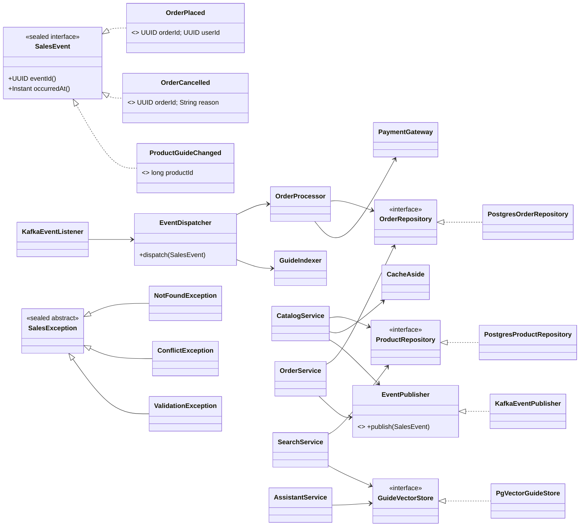
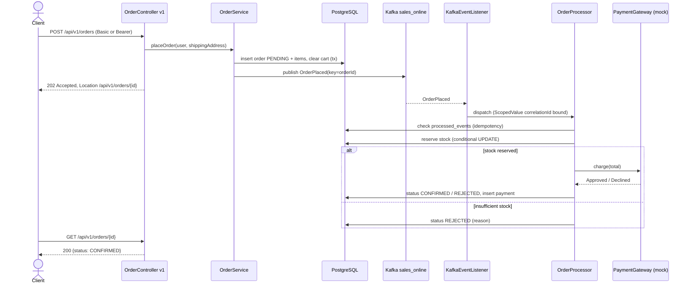
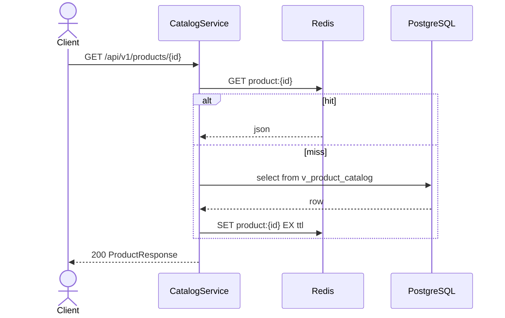

# Sales Online - Implementation Plan

E-commerce engine exposed as a versioned REST API. Java 25 (preview enabled), Spring Boot 4.1, PostgreSQL + pgvector, Redis, Kafka.

Status: **Phase 1 (scaffolding) complete. Phase 2 (database) next.**

## 0. Decisions and Assumptions

### Confirmed by user

| Topic | Decision |
|---|---|
| Authentication | HTTP Basic (local users, BCrypt) **and** OAuth2 bearer JWT issued by an external OAuth2 broker (separate project). The API is only an OAuth2 resource server. No Keycloak, no Spring Authorization Server. |
| AI | Cloud API for embeddings and RAG answers. |
| Test data | Download real products from a public API, generate detailed user guides, commit the result as a seed file. |
| Scope | Standard MVP: users, categories, products, inventory, cart, orders, mock payment, full-text + semantic search, AI Q&A. |
| Async via Kafka | Order placement, order cancellation, guide re-embedding after product create/update. |
| Infrastructure | No Docker/Testcontainers. Postgres 192.168.0.101:5432, Redis localhost:6379, Kafka localhost:9092 (verified reachable). |

### Confirmed assumptions

| # | Decision |
|---|---|
| A1 | **OpenAI** for both embeddings (`text-embedding-3-small`, 1536 dims) and chat (`gpt-4.1-mini`), via Spring AI. Key from env var `OPENAI_API_KEY`. Swapping providers changes only config and the vector dimension. |
| A2 | OAuth2 broker: issuer `https://localhost:8443`, JWKS `https://localhost:8443/jwks`. Both can be overridden with `SALES_OAUTH2_ISSUER_URI` / `SALES_OAUTH2_JWK_SET_URI`. Roles come from a configurable claim (default `roles`, values `CUSTOMER` / `ADMIN`). The broker's self-signed certificate is trusted through a Spring Boot SSL bundle (`config/tls/broker-truststore.p12`) that the `JwtDecoder` RestClient uses. |
| A3 | Integration and E2E tests run against the real dev servers using schema `sales_online_test`, Redis DB index 1 and topic `sales_online_test`. Tests never touch dev data in `sales_online`. |
| A4 | Base package `com.example.sales`, Maven coordinates `com.example:sales`. |
| A5 | The `vector` extension is installed in database `sales`, and `sales-person` may create objects in schemas `sales_online` and `sales_online_test`. |
| A6 | Server port **`9443`** (HTTPS only, self-signed PKCS12 keystore generated with `keytool`). The OAuth2 broker already uses 8443 on the same host, so this API moved off that port. |

## 1. Technology Stack (latest stable as of 2026-10)

| Concern | Choice |
|---|---|
| Runtime | Java 25, `--enable-preview` (compiler, surefire, failsafe, spring-boot:run) |
| Framework | Spring Boot 4.1.2 (Spring Framework 7, Spring Web MVC, Jackson 3) |
| Build | Maven Wrapper (Maven 3.9.x) |
| DB access | Spring `JdbcClient` + records (no JPA: records are immutable and cannot be JPA entities) |
| Migrations | Flyway 13 (`flyway-database-postgresql`) |
| Vector | pgvector (`com.pgvector:pgvector` 0.1.6), HNSW index, cosine distance |
| AI | Spring AI 2.0.2 (`spring-ai-starter-model-openai`: `EmbeddingModel`, `ChatClient`) |
| Cache | Spring Data Redis (`StringRedisTemplate` + Jackson), explicit cache-aside |
| Messaging | Spring for Apache Kafka, topic `sales_online` |
| Security | Spring Security: `httpBasic` + `oauth2ResourceServer(jwt)` |
| API versioning | Spring Framework 7 built-in API versioning, path-segment strategy: `/api/v{version}/...` |
| Docs | springdoc-openapi 3.2.0 (code-first): `/v3/api-docs`, `/swagger-ui.html` |
| Errors | RFC 9457 `ProblemDetail` |
| Logging | Logback (`logback-spring.xml`), MDC correlation id, DEBUG for `com.example.sales` |
| Tests | JUnit 5, AssertJ, Mockito, Spring Boot test slices, Playwright for Java 1.64 (E2E) |

## 2. Architecture

### 2.1 Style

A single Maven module, packaged by feature. Each feature has a `domain` layer (records, sealed types, services, **port interfaces**) and `adapter` packages. The persistence and streaming technologies sit behind ports, and the active adapter is picked by configuration:

```yaml
sales:
  persistence.provider: postgres   # future: dynamodb
  messaging.provider: kafka        # future: kinesis
```

Adapters are annotated `@ConditionalOnProperty(name = "sales.persistence.provider", havingValue = "postgres")` and so on. Only the Postgres and Kafka adapters are built now. Adding DynamoDB/Kinesis later means adding new adapter packages, with no change to domain code.

### 2.2 Package layout

```
com.example.sales
  SalesApplication
  common/        error (ProblemDetail advice, sealed SalesException), logging (CorrelationFilter, ScopedValue context),
                 cache (CacheAside helper), config (security, openapi, virtual threads)
  user/          domain (User, Role, UserRepository port, UserService), api (v1 controllers + DTO records), persistence/postgres
  catalog/       domain (Category, Product, ProductRepository, InventoryRepository, CatalogService),
                 api, persistence/postgres
  search/        domain (SearchService, GuideVectorStore port, GuideChunker), persistence/postgres (pgvector + tsvector)
  ai/            domain (AssistantService - RAG over guide chunks), api
  cart/          domain (Cart, CartItem, CartRepository, CartService), api, persistence/postgres
  order/         domain (Order, OrderStatus, OrderRepository, OrderService, OrderProcessor, PaymentGateway mock),
                 api, persistence/postgres
  messaging/     domain (sealed SalesEvent, EventPublisher port, EventDispatcher), kafka (KafkaEventPublisher, KafkaEventListener)
  seed/          SeedDataLoader (loads committed seed file on first start), SeedDataGenerator (one-off dev tool)
```

### 2.3 Modern Java feature map

| Feature | Where |
|---|---|
| Virtual threads | `spring.threads.virtual.enabled=true` (Tomcat requests, Kafka listener, `@Async`). Seed embedding runs on `Executors.newVirtualThreadPerTaskExecutor()`. |
| Structured concurrency (preview) | Hybrid search runs full-text and vector search in parallel with `StructuredTaskScope.open()`. Product details load product, stock and guide summary in parallel. |
| Records | All DTOs, domain models, events, config properties (`@ConfigurationProperties` records), DB row mappings. |
| Sealed classes/interfaces | `SalesEvent` (OrderPlaced, OrderCancelled, ProductGuideChanged), `SalesException` hierarchy, `SearchMode`, `PaymentResult` (Approved / Declined). |
| `var` | Local variables throughout. |
| Switch expressions | Status transitions, mapping exceptions to HTTP status. |
| Pattern matching (`switch`, `instanceof`) | `EventDispatcher` switch over sealed `SalesEvent` with record deconstruction. Error advice. Authentication principal (`Jwt` vs `UserDetails`). |
| Text blocks | All SQL statements, LLM prompts, OpenAPI descriptions. |
| Unnamed `_` | Unused lambda/catch parameters, record patterns where components are ignored. |
| Stream gatherers | `Gatherers.windowFixed(n)` batches guide chunks for embedding calls. A custom `Gatherer` builds overlapping text chunks. |
| Module import declarations | `import module java.base;` in utility/seed classes. |
| Scoped values | `RequestContext` (correlation id, user id) bound per request in a filter and inherited by structured-concurrency subtasks. Also bound in the Kafka listener from the message headers. |
| Flexible constructor bodies | Validation before `super(...)` in `SalesException` subclasses and in `Money` / value types. |
| Markdown doc comments | `///` Javadoc on all public types. |
| Mermaid diagrams | Section 3 here, maintained in `docs/ARCHITECTURE.md`. |

### 2.4a PostgreSQL feature map (educational)

The schema intentionally shows PostgreSQL-specific types wherever they fit naturally:

| Feature | Objects | Usage |
|---|---|---|
| Custom domains | `email_address` (citext + regex check), `sku_code` (`^[A-Z0-9-]{4,32}$`), `money_amount` (`numeric(12,2) check >= 0`), `currency_code` (`char(3)` upper-case check), `positive_qty` (`int check > 0`), `rating` (`numeric(2,1) check 0..5`), `order_status` (`varchar check in (...)`) | Column types across all tables. Constraint violations map to 400/409 problem responses. |
| Composite types | `postal_address (line1, line2, city, region, postal_code, country_code)`, `dimensions_cm (width, height, depth)`, `price_tag (amount money_amount, currency currency_code)` | `users.default_address`, `orders.shipping_address`, `products.dimensions`, `order_items.unit_price`. Written with `ROW(...)::postal_address` and read with `(col).field` in SQL text blocks, then mapped to Java records. |
| Arrays | `products.tags text[]`, `products.image_urls text[]`, `products.guide_sections text[]` (section headings), `users.roles varchar[]` | GIN index on `tags`. Product list filter `?tag=a&tag=b` uses `tags && ?` (any) or `tags @> ?` (all, `matchAll=true`). `unnest` is used in a view. |
| JSONB | `products.attributes` (specifications: weight, warranty, shipping and return policy, model-specific specs), `users.preferences`, `orders.status_history` (array of `{status, at, reason}` appended with `||`), `payments.gateway_response`, `processed_events.payload`, `product_guide_chunks.metadata` (section, word count) | GIN `jsonb_path_ops` index on `attributes`. Product filter `?attr=brand_color:black` uses `attributes @> ?::jsonb`. Statistics view uses `jsonb_build_object` / `jsonb_agg`. |
| Generated column | `products.search_vector tsvector` | Full-text search. |
| Views | `v_product_catalog` (product + category + stock + `in_stock`), `v_order_summary` (order + items as `jsonb_agg` + flattened address fields), `v_category_stats` (product count, price range, distinct tags via lateral `unnest(tags)`, `jsonb` summary) | Read models for catalog, orders and admin statistics. |

Java mapping stays simple: JSONB maps to/from records with Jackson (`?::jsonb` parameters, `JdbcClient` row mappers). Arrays use `String[]` and `java.sql.Array`. Composite types are expanded in SQL so no custom JDBC type is needed.

### 2.4 Security

- One `SecurityFilterChain` with both `httpBasic()` and `oauth2ResourceServer(jwt)`.
- Basic: `UserDetailsService` backed by the `users` table (BCrypt).
- JWT: `NimbusJwtDecoder` built from `jwk-set-uri` `https://localhost:8443/jwks`, validating the issuer `https://localhost:8443` and expiry (A2). JWKS is fetched over TLS with the broker truststore SSL bundle. A `JwtAuthenticationConverter` maps the role claim to `ROLE_*`. On the first request, a user row is provisioned automatically (`auth_provider='OAUTH2'`, `external_id=sub`), so carts and orders work the same for both login types.
- Roles: `CUSTOMER`, `ADMIN`. Public endpoints: `POST /api/v1/auth/register`, `GET` catalog/search, OpenAPI/Swagger, `/actuator/health`.
- TLS: `server.ssl` with a self-signed PKCS12 keystore in `config/tls/` (generated by a script, gitignored). The certificate is exported so clients can trust it.

### 2.5 Cache-aside (Redis)

`CacheAside.get(key, type, ttl, loader)`: read Redis. On a miss, call the loader (DB), write with a TTL, and return. Writes go to the DB first, then evict the key.
Cached: `product:{id}`, `category:all`, `product-page:{category}:{page}:{size}` (short TTL). Redis failures are logged and fall through to the DB.

### 2.6 Kafka flow

- Topic `sales_online` (created by a `NewTopic` bean, 3 partitions). Key = aggregate id (orderId / productId), so ordering holds per aggregate.
- Value = JSON of the sealed `SalesEvent`, with the type in Jackson `@JsonTypeInfo`. Headers carry the correlation id.
- `POST /api/v1/orders`: validates the cart, inserts the order `PENDING` and its items (price snapshot), clears the cart, publishes `OrderPlaced`, and returns `202 Accepted` with `Location: /api/v1/orders/{id}`.
- The listener processes the event in one DB transaction: reserves stock (`UPDATE inventory SET quantity = quantity - n WHERE quantity >= n`), calls the mock payment, and sets the order to `CONFIRMED` or `REJECTED` with a reason.
- Idempotency: table `processed_events(event_id)`, so a duplicate delivery is a no-op. Retry uses `DefaultErrorHandler` with backoff, then dead-letter topic `sales_online.DLT`.
- `ProductGuideChanged`: the listener re-chunks and re-embeds the guide and replaces the rows in `product_guide_chunks`.

### 2.7 Search and AI

- Full-text: a generated `tsvector` column on `products` (name A, brand/category B, description C, user_guide D) with a GIN index. Queried with `websearch_to_tsquery` + `ts_rank_cd`.
- Semantic: the guide is split into ~1,000-char chunks with 150-char overlap, each embedded and stored as `vector(1536)` with an HNSW (`vector_cosine_ops`) index. The query embedding is matched by cosine distance and grouped per product.
- Hybrid: both run in parallel (structured concurrency) and are merged with Reciprocal Rank Fusion.
- `POST /api/v1/ai/ask {question, productId?}`: retrieves the top-k chunks (optionally limited to one product) and has `ChatClient` answer from that context only. The response lists the source products and chunks.

### 2.8 Test data

`SeedDataGenerator` (a one-off dev tool, run via a Maven profile):
1. Downloads all ~194 products from `https://dummyjson.com/products?limit=0` (name, brand, SKU, price, stock, description, images).
2. Maps the 24 source categories into **10 categories**: Smartphones & Tablets, Laptops & Computers, Mobile Accessories, Kitchen & Appliances, Home & Furniture, Sports & Outdoors, Watches & Eyewear, Beauty & Fragrance, Fashion, Vehicles & Motorcycles. Grocery items are dropped, because a user guide does not fit them.
3. Generates a detailed user guide per product with the chat model, using a fixed structured prompt (text block). Sections: overview, box contents, specifications, setup, operation, advanced features, maintenance, troubleshooting (table), safety, warranty, FAQ. Target 1,500-3,000 words. Requests run on virtual threads with a concurrency limit.
4. Writes `src/main/resources/seed/products.json`, which is committed. The download and generation run once and are reproducible.

`SeedDataLoader` (runs on startup if `products` is empty): inserts categories, products and inventory, then embeds the guides in batches (`windowFixed`). Seed users: `admin/admin123` (ADMIN), `customer/customer123` (CUSTOMER), dev profile only.

### 2.9 API v1 endpoints

| Method | Path | Auth | Notes |
|---|---|---|---|
| POST | `/api/v1/auth/register` | public | create CUSTOMER (basic auth user) |
| GET | `/api/v1/users/me` | user | current profile (incl. default address, preferences) |
| PUT | `/api/v1/users/me` | user | update default address (composite) and preferences (jsonb) |
| GET | `/api/v1/categories` | public | cached |
| POST/PUT/DELETE | `/api/v1/categories[/{id}]` | ADMIN | |
| GET | `/api/v1/products?category=&tag=&matchAll=&attr=&page=&size=&sort=` | public | paged, cached; `tag` uses array operators, `attr=key:value` uses jsonb containment |
| GET | `/api/v1/admin/stats/categories` | ADMIN | from `v_category_stats` |
| GET | `/api/v1/products/{id}` | public | cached, includes stock |
| GET | `/api/v1/products/{id}/guide` | public | full user guide (text/markdown) |
| POST/PUT/DELETE | `/api/v1/products[/{id}]` | ADMIN | publishes `ProductGuideChanged` |
| PUT | `/api/v1/products/{id}/inventory` | ADMIN | set stock |
| GET | `/api/v1/search?q=&mode=fulltext\|semantic\|hybrid&limit=` | public | |
| POST | `/api/v1/ai/ask` | user | RAG answer with sources |
| GET | `/api/v1/cart` | user | |
| POST | `/api/v1/cart/items` | user | add `{productId, quantity}` |
| PATCH/DELETE | `/api/v1/cart/items/{productId}` | user | |
| DELETE | `/api/v1/cart` | user | clear |
| POST | `/api/v1/orders` | user | body: optional `shippingAddress` (defaults to the user's `default_address`); 202 + Location, async |
| GET | `/api/v1/orders`, `/api/v1/orders/{id}` | user (own) / ADMIN (all) | status polling |
| POST | `/api/v1/orders/{id}/cancel` | user/ADMIN | 202, async; releases stock |

Errors: `application/problem+json` with `type`, `title`, `status`, `detail`, `instance`, `correlationId`, and field `errors` for validation failures.

## 3. Diagrams

### 3.1 Class diagram (core domain)



### 3.2 Sequence: asynchronous order placement



### 3.3 Sequence: cache-aside product read



### 3.4 Database (schema `sales_online`)

```mermaid
erDiagram
    users ||--o| carts : owns
    users ||--o{ orders : places
    categories ||--o{ products : contains
    products ||--|| inventory : stocked
    products ||--o{ product_guide_chunks : "embedded as"
    carts ||--o{ cart_items : has
    products ||--o{ cart_items : in
    orders ||--o{ order_items : has
    products ||--o{ order_items : in
    orders ||--o| payments : paid_by

    users { uuid id PK; varchar username UK; email_address email UK; varchar password_hash "null for OAUTH2"; varchar auth_provider "LOCAL|OAUTH2"; varchar external_id UK; varchar_array roles; postal_address default_address "composite"; jsonb preferences; timestamptz created_at }
    categories { bigint id PK; varchar slug UK; varchar name; text description }
    products { bigint id PK; sku_code sku UK; bigint category_id FK; varchar name; varchar brand; text description; money_amount price; currency_code currency; rating rating; text_array tags "GIN"; text_array image_urls; dimensions_cm dimensions "composite"; jsonb attributes "GIN jsonb_path_ops"; text user_guide; text_array guide_sections; tsvector search_vector "generated, GIN"; bigint version; timestamptz created_at; timestamptz updated_at }
    inventory { bigint product_id PK; int quantity "check >= 0"; timestamptz updated_at }
    product_guide_chunks { bigint id PK; bigint product_id FK; int chunk_index; text content; jsonb metadata; vector embedding "1536, HNSW" }
    carts { uuid id PK; uuid user_id FK; timestamptz updated_at }
    cart_items { uuid cart_id PK; bigint product_id PK; positive_qty quantity }
    orders { uuid id PK; uuid user_id FK; order_status status; money_amount total; currency_code currency; postal_address shipping_address "composite"; jsonb status_history; timestamptz created_at; timestamptz updated_at }
    order_items { uuid order_id PK; bigint product_id PK; varchar product_name; price_tag unit_price "composite"; positive_qty quantity }
    payments { uuid id PK; uuid order_id FK; money_amount amount; varchar status; varchar reference; jsonb gateway_response; timestamptz created_at }
    processed_events { uuid event_id PK; varchar event_type; jsonb payload; timestamptz processed_at }
```

The ER diagram writes array columns as `text_array` / `varchar_array`, because mermaid cannot render `text[]`. Custom domains and composite types are listed in section 2.4a.

Views: `v_product_catalog`, `v_order_summary`, `v_category_stats` (see 2.4a). Indexes: GIN on `search_vector`, `tags` and `attributes`; HNSW on `embedding`; B-tree on `products(category_id)` and `orders(user_id, created_at desc)`.

## 4. Implementation Phases

Each phase ends with a green `./mvnw verify` and a commit. Check off the criteria as they are met.

### Phase 1 - Scaffolding
- [x] Maven Wrapper, `pom.xml` (Boot 4.1.2 parent, Spring AI BOM, preview flags on compiler/surefire/failsafe/spring-boot plugin)
- [x] `.gitignore` (target, IDE files, `config/tls/*.p12`, `.env`, logs, Playwright cache)
- [x] `application.yml` + `application-dev.yml` + `application-test.yml`. Secrets read from env vars with dev defaults (`SALES_DB_PASSWORD:changeit`, `OPENAI_API_KEY`)
- [x] `logback-spring.xml`: console + rolling file, pattern includes `%X{correlationId}`, DEBUG for `com.example.sales`
- [x] Self-signed keystore script `scripts/gen-cert.ps1` (keytool), HTTPS on 9443
- [x] Virtual threads enabled; `./mvnw spring-boot:run` starts and `/actuator/health` is UP over HTTPS
- [x] Connectivity verified: Postgres (`vector` extension present), Redis, Kafka
- [x] CLAUDE.md updated with build/test/run commands and an architecture overview; minimal README

### Phase 2 - Database
- [ ] Flyway `V1__types.sql` (custom domains and composite types), `V2__schema.sql` (tables using domains, composites, arrays and jsonb; constraints, generated tsvector, GIN/HNSW/B-tree indexes), `V3__views.sql`
- [ ] Flyway targets schema `sales_online` (dev) / `sales_online_test` (test)
- [ ] Integration tests: migrations apply cleanly on an empty test schema; views return rows; each domain rejects invalid values (bad email, negative price, lower-case currency, zero quantity); composite round-trip (`postal_address` write/read); array filter (`&&`, `@>`) and jsonb containment (`@>`) queries use their GIN indexes (`EXPLAIN` check)

### Phase 3 - Cross-cutting
- [ ] `RequestContext` with `ScopedValue`, `CorrelationFilter` (header `X-Correlation-Id`, MDC)
- [ ] Sealed `SalesException` hierarchy + `@RestControllerAdvice` returning `ProblemDetail` (pattern-matching switch); validation errors mapped
- [ ] `CacheAside` helper (Redis, TTL, JSON, fall-through on Redis failure)
- [ ] Unit tests: exception mapping, `CacheAside` hit/miss/evict/Redis-down, correlation filter

### Phase 4 - Security and users
- [ ] Security chain: Basic + JWT resource server, role mapping, public paths
- [ ] Register endpoint, `GET/PUT /users/me` (composite address, jsonb preferences, roles array), BCrypt, JWT user auto-provisioning
- [ ] JWT decoder: JWKS `https://localhost:8443/jwks`, issuer `https://localhost:8443`, broker truststore SSL bundle
- [ ] Unit/slice tests: 401 without credentials, 401 on wrong issuer/expired token, 403 on admin endpoints for CUSTOMER, Basic login, mock-JWT login (`jwt()` post-processor), role claim mapping

### Phase 5 - Catalog and inventory
- [ ] Ports + Postgres adapters (`JdbcClient`, text-block SQL, record mapping)
- [ ] Category/product/inventory services and v1 controllers with cache-aside and eviction
- [ ] Product list filters: tags (array `&&` / `@>`), attributes (jsonb `@>`); admin category stats from `v_category_stats`
- [ ] Product details uses structured concurrency (product, stock, guide summary)
- [ ] Tests: service unit tests (mocked ports), `@WebMvcTest` controller tests, repository integration tests

### Phase 6 - Messaging
- [ ] Sealed `SalesEvent` records, `EventPublisher` port, Kafka adapter, topic + DLT beans
- [ ] `KafkaEventListener` -> `EventDispatcher` (pattern-matching switch), `processed_events` idempotency, correlation id from headers bound as `ScopedValue`
- [ ] Adapters selected by `sales.messaging.provider` / `sales.persistence.provider`. The context fails fast with a clear message for an unknown provider
- [ ] Tests: dispatcher unit tests per event type, duplicate-event no-op, integration test publish -> consume against local Kafka

### Phase 7 - Cart and orders
- [ ] Cart endpoints and service (stock check on add)
- [ ] Order placement (202) with composite shipping address (request or user default), `OrderProcessor` (stock reservation, mock payment with jsonb `gateway_response`, status + `status_history` jsonb append), cancel (releases stock), ownership checks
- [ ] Tests: unit tests for status transitions, insufficient stock, payment declined, cancel rules; integration test of the full async flow (Awaitility)

### Phase 8 - Seed data, search and AI
- [ ] `SeedDataGenerator`: download from DummyJSON, map to 10 categories, generate detailed guides, write `seed/products.json` (committed; about 150-190 products). Source fields map to `tags` (array), `images` (array), `dimensions` (composite), and weight/warranty/shipping/return policy into `attributes` (jsonb)
- [ ] `SeedDataLoader`: idempotent load + batched embeddings (`Gatherers.windowFixed`, custom chunking `Gatherer`, virtual threads)
- [ ] Full-text, semantic and hybrid search (structured concurrency + RRF)
- [ ] `ProductGuideChanged` re-embedding via Kafka
- [ ] `POST /api/v1/ai/ask` RAG with sources
- [ ] Tests: chunker/gatherer unit tests, RRF merge, search integration tests (fake `EmbeddingModel` in unit tests; real API in one integration test, skipped when no key)
- [ ] Verified: every guide is at least 1,500 words; all 10 categories populated; every product has embeddings

### Phase 9 - OpenAPI, Swagger and versioning
- [ ] Spring API versioning configured (path segment, supported versions `1`, default rejects unknown versions with 400)
- [ ] springdoc: `/v3/api-docs`, `/swagger-ui.html`, Basic + Bearer security schemes, grouped by version, examples on DTOs
- [ ] Tests: unknown version `/api/v9/...` returns a problem response; api-docs contain all v1 paths

### Phase 10 - End-to-end tests and hardening
- [ ] Playwright for Java (`APIRequestContext`, ignore self-signed HTTPS) E2E suite in failsafe profile `e2e`, against the running server: register, login (Basic), update profile address, browse with tag/attribute filters, search (3 modes), cart, place order -> poll to CONFIRMED, insufficient stock -> REJECTED, cancel, admin product update -> cache evicted + re-embedded, AI ask, error formats, auth failures
- [ ] OAuth2 E2E with a real token from the external broker at `https://localhost:8443`
- [ ] Playwright browser test: Swagger UI loads and lists the v1 endpoints
- [ ] All found defects fixed; full `./mvnw verify` and E2E suite green
- [ ] `docs/ARCHITECTURE.md` with the final mermaid diagrams
- [ ] Server running on `https://localhost:9443` with seeded data, ready for use

## 5. Definition of Done

- All phase criteria checked.
- `./mvnw verify` green (unit + integration), E2E suite green.
- Every listed modern Java feature appears in the code where it naturally fits.
- Server running with seed data. Swagger UI is reachable, and both Basic and OAuth2 access work.
